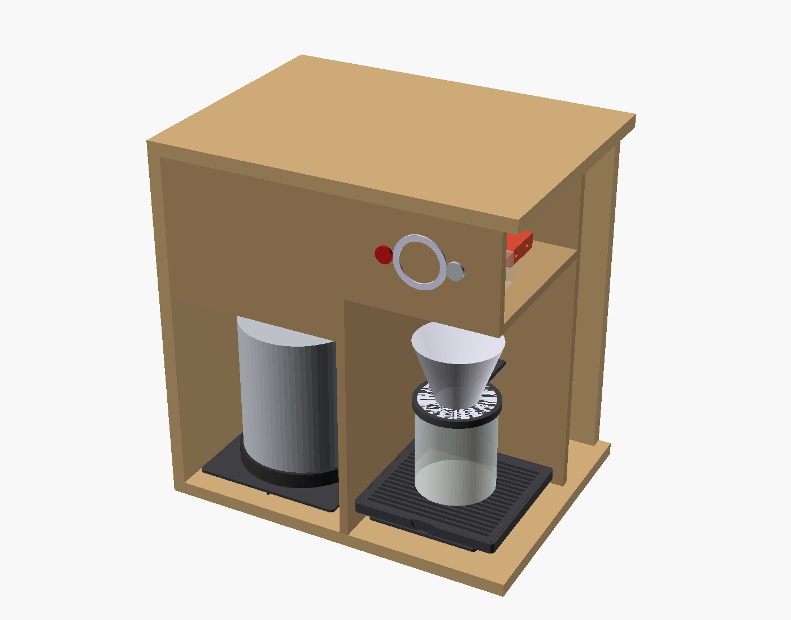

# Coffee machine (automatic pour-over brewer)

**Status:** designing (draft 1)
**Started:** 2026-11-07



## Goal

An automatic pour-over machine built around a standard Hario V60-02 insert and its paper filters. It controls the pour pattern (programmable spirals from a moving nozzle), water temperature and flow, and logs plenty of sensor data. You run it from a phone, or with physical **Brew** and **Off** buttons when no phone is handy.

"Done" means it brews a repeatable 1-cup V60 (default 15 g coffee to 250 g water at 93 °C) from the Brew button, and every safety interlock below has been tested.

## Architecture

```
plain kettle (side bay, on kettle scale) ──> dip wand + PT1000
   │  switched by UL-listed relay outlet; machine holds ~90 °C
   ▼
peristaltic pump (24 V stepper) ──> Digmesa flow meter (~90 °C, coolest point)
   ▼
trim heater: 316 SS tube clamped in aluminium block, 24 V ~150 W cartridge
   ▼
316 SS tee + PT1000 (true brew temp) ──> polar nozzle (rotate + radial slide)
   ▼
V60-02 on cantilevered load cell ──> carafe on scale, drip tray
```

The kettle and the 24 V supply are the only mains-powered parts, and both are bought listed units. Everything we wire ourselves runs at 24 V or below.

**Food-safety rule:** the water only touches bought food-grade parts: the kettle, 316 stainless tube, platinum silicone tubing, the Digmesa meter (LFGB), the PT1000 sheaths, the V60 and the carafe. Printed and wooden parts stay dry apart from drips and steam.

## Safety requirements

| Risk | Physical guard | Software guard |
|---|---|---|
| Hot heater block | Fully enclosed and insulated; touchable surfaces ≤ 50 °C; 120 °C cutout breaks heater power on its own | Block temperature cap |
| Dry heating | 120 °C cutout | Heater only on while the flow meter sees flow |
| Spray or splash | Open outlet, so no pressure builds; nozzle sits low over the cone | Pump only runs with cone and carafe detected |
| Overflow | Drip tray | Stop on a sudden weight jump or when the target is passed |
| Stuck software | Latching **Off** button in the main 24 V line kills everything, and the kettle relay drops with it | Watchdog: heater and pump default off |
| Remote/timed start into an empty bay | n/a | Checked at scheduling and again at start: kettle seated with enough water (kettle scale), cone and carafe present (and the coffee dose, by weight), sensors sane, flow seen within a few seconds. On failure it cancels and notifies |
| Hot lines | Routed inside the body in insulated sleeve | n/a |

## Key dimensions (draft 1)

All values live in `src/params.scad`.

| Feature | mm | in |
|---|---|---|
| Overall W × D × H | 478 × 360 × 508 | 18.8 × 14.2 × 20.0 |
| Kettle bay (W × D × H) | 240 × 230 × 280 | 9.4 × 9.1 × 11.0 |
| Brew bay (W × D × H) | 200 × 230 × 340 | 7.9 × 9.1 × 13.4 |
| V60 seat height above base top | 173 | 6.8 |
| Nozzle tip above V60 rim | 25 | 1.0 |
| Spiral radius needed | 0–45 | 0–1.8 |

## Parts

| Part | Made by | Source file | Export | Notes |
|---|---|---|---|---|
| Panels and dividers | In-house (table saw) | `src/assembly.scad` | see cut list | Birch ply, dados for shelves |
| Trim heater block (top and bottom halves) | Xometry or PCBWay CNC, 6061-T6 | `src/trim_heater_block.py` | `exports/trim_heater_block_{top,bottom}.step` | Holes: M4 tap drill 3.3 in the bottom half, M4 clearance in the top |
| V60 holder | JLC3DP MJF PA12 | `src/printed_inserts.scad` | `exports/v60_holder.stl` | Locates the V60 base plate, with a handle gap facing front |
| Cone load-cell mount | JLC3DP MJF PA12 | 〃 | `exports/cone_lc_mount.stl` | Screws to the rear divider |
| Drip tray + grate | JLC3DP MJF PA12 | 〃 | `exports/drip_tray.stl`, `drip_grate.stl` | |
| Carafe and kettle scale platforms | JLC3DP MJF PA12 | 〃 | `exports/carafe_platform.stl`, `kettle_platform.stl` | M4 heat-set inserts |
| Load-cell spacers (×3) | JLC3DP MJF PA12 | 〃 | `exports/lc_spacer.stl` | |
| Pump cradle | JLC3DP MJF PA12 | 〃 | `exports/pump_cradle.stl` | Resize once the pump is chosen |
| Electronics tray | JLC3DP / Craftcloud PETG | 〃 | `exports/electronics_tray.stl` | 10 mm pegboard of M3 inserts |
| Nozzle mechanism | not yet designed | `src/assembly.scad` (envelope only) | n/a | Next design task |

## Cut list (in-house)

**18 mm birch ply** (fits on one 1220 × 1220 / 4 × 4 ft sheet)

| Part | Qty | mm | in |
|---|---|---|---|
| Base | 1 | 478 × 360 | 18.8 × 14.2 |
| Top | 1 | 478 × 360 | 18.8 × 14.2 |
| Sides | 2 | 360 × 472 | 14.2 × 18.6 |
| Back (service panel, screwed) | 1 | 442 × 472 | 17.4 × 18.6 |

**12 mm birch ply** (fits on one 610 × 1220 / 2 × 4 ft sheet)

| Part | Qty | mm | in |
|---|---|---|---|
| Rear divider | 1 | 442 × 472 | 17.4 × 18.6 |
| Bay divider | 1 | 230 × 472 | 9.1 × 18.6 |
| Kettle bay shelf | 1 | 240 × 230 | 9.4 × 9.1 |
| Brew bay shelf | 1 | 200 × 230 | 7.9 × 9.1 |
| Kettle fascia | 1 | 240 × 180 | 9.4 × 7.1 |
| Brew fascia (buttons, LED ring) | 1 | 200 × 120 | 7.9 × 4.7 |

Add 6 mm (¼") to shelf and divider lengths that sit in dados. Cut the dados on the table saw with a dado stack or multiple passes.

## Fabrication notes

- **JLC3DP MJF PA12:** keep walls at least 1.2 mm (this draft uses 3 mm) and 0.3 mm clearance on fits. PA12 has a high heat deflection temperature, so it's fine near steam. Request natural or black dyed.
- **CNC heater block:** 6061-T6 with a standard ±0.13 mm tolerance. The tube groove and heater bore are half-round on the joint face, so tell the shop the halves are machined as a pair. Clamp with 8× M4 and fill the grooves with thermal paste.
- **Tube bending:** the 1/4" 316 tube gets one U-bend at R16 (2.5 × OD) for the heater serpentine. Use a lever tube bender, not by hand.
- **Costs:** every BOM price is an estimate. Get real quotes from JLC3DP and Xometry before ordering.

## Build steps (outline)

1. Buy the kettle and relay outlet first, and confirm the kettle resumes heating when outlet power returns.
2. Measure the real V60 base plate, kettle, carafe, load cells and pump, then update the `VERIFY` values in `src/params.scad` and run `exports/build.sh`.
3. Cut the panels and dados, then dry fit.
4. Order the printed inserts and the heater block.
5. Bench test the water path (kettle → pump → meter → heater → tee) over a sink before installing.
6. Wire the electronics on the tray. Run every interlock test before the first real brew.
7. Finish the wood with hardwax oil and assemble.

## Open items

- Design the nozzle mechanism: polar (rotate + radial slide) with a hollow hub and limited turns, or a 5-bar SCARA arm with no tube twist.
- Choose the kettle model and confirm it fits the bay, its switch latches, and heating with the dip wand in place is safe.
- Decide how the dip wand enters the kettle: through the open lid on a hinged arm, or down the spout.
- Write the firmware: ESP32 web app, recipes, PID loops and interlocks.
- Confirm the Brew-button default recipe (assumed 15 g to 250 g at 93 °C).
- The BOM's estimated total is about $945. The biggest costs are the CNC heater block, pump, PA12 prints and plywood.

## Rebuilding exports

```
./exports/build.sh     # needs openscad, python3 + cadquery, xvfb-run (headless)
```

## Log

- 2026-11-07: started. Settled on an automatic pour-over brewer with a V60-02 insert, a plain kettle in a side bay switched by a relay outlet, a 24 V trim heater, PT1000 sensors, a Digmesa flow meter, three load cells, and phone plus button control. Draft 1 of the CAD and BOM is done.
