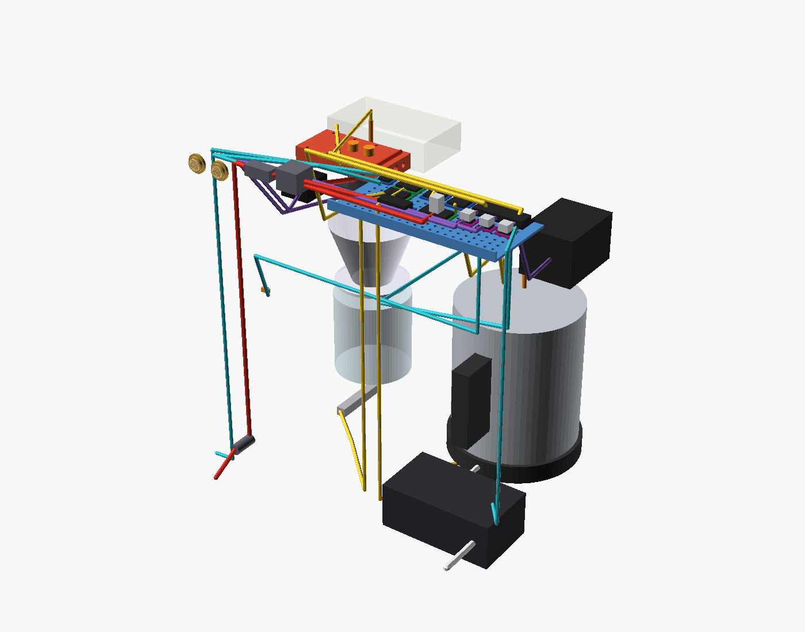

# Coffee machine (automatic pour-over brewer)

**Status:** designing (draft 2)
**Started:** 2026-11-07


**Interactive 3D model and BOM:** [Pour-Over Machine](https://claude.ai/artifact/FuLXcmYcK9QPcySvpjs3qe) (private artifact, built from `viewer/index.html` by `exports/build.sh`).

## Goal

An automatic pour-over machine built around a standard Hario V60-02 insert and its paper filters. It controls the pour pattern (programmable spirals from a moving nozzle), water temperature and flow, and logs plenty of sensor data. You run it from a phone, or with brass **Power** and **Brew** buttons on the back when no phone is handy.

Only the carafe shows from the front. The kettle sits behind a push-to-open door, the V60 rides in a hidden drawer whose front is flush with the door, and the cabinet floats on a recessed plinth with an LED strip that glows onto the counter (a slow pulse while brewing).

"Done" means it brews a repeatable 1-cup V60 (default 15 g coffee to 250 g water at 93 °C) from the Brew button, and every safety interlock below has been tested.

## Architecture

```
plain kettle (side bay, on kettle scale) ──> dip wand + PT1000
   │  switched by UL-listed relay outlet; machine holds ~90 °C
   ▼
peristaltic pump (24 V stepper) ──> Digmesa flow meter (~90 °C, coolest point)
   ▼
trim heater: 316 SS tube clamped in aluminium block, 24 V ~150 W cartridge
   ▼
316 SS tee + PT1000 (true brew temp) ──> polar nozzle (rotate + radial slide)
   ▼
V60-02 in hidden drawer (ToF sensor above) ──> carafe on scale, drip tray
```

The kettle and the 24 V supply are the only mains-powered parts, and both are bought listed units. Everything we wire ourselves runs at 24 V or below.

**Food-safety rule:** the water only touches bought food-grade parts: the kettle, 316 stainless tube, platinum silicone tubing, the Digmesa meter (LFGB), the PT1000 sheaths, the V60 and the carafe. Printed and wooden parts stay dry apart from drips and steam.

## Safety requirements

| Risk | Physical guard | Software guard |
|---|---|---|
| Hot heater block | Fully enclosed and insulated; touchable surfaces ≤ 50 °C; 120 °C cutout breaks heater power on its own | Block temperature cap |
| Dry heating | 120 °C cutout | Heater only on while the flow meter sees flow |
| Spray or splash | Open outlet, so no pressure builds; nozzle inside a shroud over the cone, behind the closed drawer front | Pump only runs with the drawer closed (reed switch), cone seen by the ToF sensor, and carafe on the scale |
| Overflow | Drip tray | Stop on a sudden weight jump or when the target is passed |
| Stuck software | Latching brass **Power** button on the back switches the main 24 V relay, so releasing it kills everything and the kettle relay drops with it | Watchdog: heater and pump default off |
| Remote/timed start into an empty bay | n/a | Checked at scheduling and again at start: kettle seated with enough water (kettle scale), cone and carafe present (and the coffee dose, by weight), sensors sane, flow seen within a few seconds. On failure it cancels and notifies |
| Hot lines | Routed inside the body in insulated sleeve | n/a |
| Kettle heat and steam in a closed bay | Intake slots in the base overhang, exhaust slots high in the left side | Door switch: remote and timed starts need the kettle door closed |

## Electronics and wiring (draft)

All control electronics sit on the PETG tray at the top of the rear tech strip, behind the rear divider and above any water. Cables reach the front through 20 mm grommet holes in the divider. The model shows each run, colored by circuit (see the `assembly_wiring` render and the viewer's layer toggles).



**Power path:** 24 V brick → panel DC jack (back) → 10 A blade fuse → main relay (coil switched by the latching brass **Power** button) → 24 V bus to the heater MOSFET, 3× TMC2209, LED strip, button rings and the 24→5 V buck that feeds the ESP32 and sensor boards. The kettle's mains path never enters our wiring. The kettle base plugs into the listed relay outlet, which plugs into the wall, and the ESP32 drives only that outlet's low-voltage control input.

| Circuit | From (tray) | To | Cable | Notes |
|---|---|---|---|---|
| 24 V in | DC jack | fuse → relay → tray bus | 16 AWG pair | Only the relay coil runs through the brass Power button |
| Heater | MOSFET module | 24 V cartridge via 2× 120 °C cutouts in series | 16 AWG silicone | Cutouts break heater power without the controller |
| Heater NTC | ESP32 ADC | NTC in heater block | 22 AWG pair, fibreglass sleeve | |
| Kettle temp | MAX31865 #1 | PT1000 on the dip wand | 3-wire shielded | |
| Brew temp | MAX31865 #2 | PT1000 in the 316 tee before the nozzle | 3-wire shielded | |
| Flow | ESP32 interrupt pin | Digmesa Nano Inox | 3-core (V+, GND, pulse) | Pulse is open collector: 10 k pull-up to 3.3 V |
| Carafe weight | HX711 #1 | 5 kg load cell under the drip tray | 4-core | |
| Kettle weight | HX711 #2 | 5 kg load cell under the kettle platform | 4-core | Water remaining, for the start interlocks |
| Cone check and bed height | ESP32 I2C | VL53L1X in the nozzle shroud | 4-core | |
| Door closed | ESP32 input | Reed switch on the bay divider front | 2-core | Magnet in the kettle door |
| Drawer closed | ESP32 input | Reed switch at the rear of the drawer bay | 2-core | Magnet in the drawer tray |
| Pump | TMC2209 #1 | Peristaltic pump stepper | 4-core stepper | |
| Nozzle rotate, radial | TMC2209 #2, #3 | Two NEMA 17 pancake steppers | 4-core stepper | Concept until the mechanism is designed |
| Base glow | Level shifter | 24 V addressable strip under the base | 3-core (24 V, GND, data) | Through a hole in the base inside the plinth |
| Buttons | ESP32 input + 24 V | Brass Power and Brew on the back | 4-core each | Brew's LED ring is driven through a small transistor |
| Kettle | ESP32 output | Relay outlet control input (3–48 V DC) | 2-core | Outlet is off whenever the controller is off |

**ESP32-S3 pin plan** (DevKitC-1-N8 without octal PSRAM, so GPIO35–37 are free; VERIFY against the board you buy):

| Function | GPIO |
|---|---|
| SPI SCK, MOSI, MISO (MAX31865 ×2) | 12, 11, 13 |
| MAX31865 chip selects | 10, 9 |
| I2C SDA, SCL (VL53L1X) | 8, 18 |
| HX711 carafe DT, SCK | 4, 5 |
| HX711 kettle DT, SCK | 6, 7 |
| Heater NTC (ADC1) | 1 |
| Flow meter pulse | 2 |
| Heater PWM | 14 |
| Pump STEP, DIR | 15, 16 |
| Nozzle rotate STEP, DIR | 17, 21 |
| Nozzle radial STEP, DIR | 42, 41 |
| Stepper enable (shared), TMC UART | 40, 39 |
| LED strip data (via 74AHCT125) | 38 |
| Door reed, drawer reed, Brew button | 35, 36, 37 |
| Brew LED ring, kettle relay outlet | 48, 47 |

## Key dimensions (draft 2)

All values live in `src/params.scad`.

| Feature | mm | in |
|---|---|---|
| Overall W × D × H (fronts and plinth included) | 478 × 378 × 533 | 18.8 × 14.9 × 21.0 |
| Plinth height, inset from each edge | 25, 25 | 1, 1 |
| Kettle bay (W × D × H) | 240 × 230 × 280 | 9.4 × 9.1 × 11.0 |
| Brew bay (W × D × H) | 200 × 230 × 340 | 7.9 × 9.1 × 13.4 |
| V60 seat height above base top | 181 | 7.1 |
| Carafe top to drawer-front bottom | 4 | 0.16 |
| Nozzle tip above V60 rim | 25 | 1.0 |
| Spiral radius needed | 0–45 | 0–1.8 |

## Parts

| Part | Made by | Source file | Export | Notes |
|---|---|---|---|---|
| Panels, dividers, plinth | In-house (table saw) | `src/assembly.scad` | see cut list | Birch ply, dados for shelves |
| Kettle door and drawer front | In-house (table saw, drill + 35 mm Forstner) | `src/assembly.scad` | see cut list | Cut side by side from one panel so the grain runs across |
| Trim heater block (top and bottom halves) | Xometry or PCBWay CNC, 6061-T6 | `src/trim_heater_block.py` | `exports/trim_heater_block_{top,bottom}.step` | Holes: M4 tap drill 3.3 in the bottom half, M4 clearance in the top |
| Cone drawer tray | JLC3DP MJF PA12 | `src/printed_inserts.scad` | `exports/drawer_tray.stl` | Seats the V60 base plate, handle gap to the front, splash wall, on 200 mm slides |
| Nozzle shroud | JLC3DP MJF PA12 | 〃 | `exports/nozzle_shroud.stl` | Hangs from the brew shelf; holds the VL53L1X ToF sensor |
| Drip tray + grate | JLC3DP MJF PA12 | 〃 | `exports/drip_tray.stl`, `drip_grate.stl` | |
| Carafe and kettle scale platforms | JLC3DP MJF PA12 | 〃 | `exports/carafe_platform.stl`, `kettle_platform.stl` | M4 heat-set inserts |
| Load-cell spacers (×2) | JLC3DP MJF PA12 | 〃 | `exports/lc_spacer.stl` | |
| Pump cradle | JLC3DP MJF PA12 | 〃 | `exports/pump_cradle.stl` | Resize once the pump is chosen |
| Electronics tray | JLC3DP / Craftcloud PETG | 〃 | `exports/electronics_tray.stl` | 10 mm pegboard of M3 inserts |
| Nozzle mechanism | not yet designed | `src/assembly.scad` (envelope only) | n/a | Next design task |

## Cut list (in-house)

**18 mm birch ply** (fits on one 1220 × 1220 / 4 × 4 ft sheet)

| Part | Qty | mm | in |
|---|---|---|---|
| Base | 1 | 478 × 360 | 18.8 × 14.2 |
| Top | 1 | 478 × 360 | 18.8 × 14.2 |
| Sides | 2 | 360 × 472 | 14.2 × 18.6 |
| Back (service panel, screwed; 2× 19 mm holes for the brass buttons) | 1 | 442 × 472 | 17.4 × 18.6 |
| Kettle door | 1 | 260 × 503 | 10.2 × 19.8 |
| Drawer front | 1 | 210 × 318 | 8.3 × 12.5 |
| Plinth long rails (on edge) | 2 | 428 × 25 | 16.9 × 1.0 |
| Plinth short rails (on edge) | 2 | 274 × 25 | 10.8 × 1.0 |

**12 mm birch ply** (fits on one 610 × 1220 / 2 × 4 ft sheet)

| Part | Qty | mm | in |
|---|---|---|---|
| Rear divider | 1 | 442 × 472 | 17.4 × 18.6 |
| Bay divider | 1 | 230 × 472 | 9.1 × 18.6 |
| Kettle bay shelf | 1 | 240 × 230 | 9.4 × 9.1 |
| Brew bay shelf | 1 | 200 × 230 | 7.9 × 9.1 |
| Kettle fascia | 1 | 240 × 180 | 9.4 × 7.1 |
| Brew fascia (behind the drawer front) | 1 | 200 × 120 | 7.9 × 4.7 |

Add 6 mm (¼") to shelf and divider lengths that sit in dados. Cut the dados on the table saw with a dado stack or multiple passes.

Cut the kettle door and drawer front next to each other from one piece (260 + 2.5 + 210 wide) so the grain carries across the front. Bore the hinge cups 35 mm × 12 mm deep, with the cup edge 3–4 mm from the door edge, per the hinge maker's template.

Vent slots: 8 mm wide in the base overhang under the kettle bay (outside the plinth) and 8 × 30 mm in the left side just under the kettle shelf. A plunge router or a row of drilled holes joined with a jigsaw both work.

## Fabrication notes

- **JLC3DP MJF PA12:** keep walls at least 1.2 mm (this draft uses 3 mm) and 0.3 mm clearance on fits. PA12 has a high heat deflection temperature, so it's fine near steam. Request natural or black dyed.
- **CNC heater block:** 6061-T6 with a standard ±0.13 mm tolerance. The tube groove and heater bore are half-round on the joint face, so tell the shop the halves are machined as a pair. Clamp with 8× M4 and fill the grooves with thermal paste.
- **Tube bending:** the 1/4" 316 tube gets one U-bend at R16 (2.5 × OD) for the heater serpentine. Use a lever tube bender, not by hand.
- **LED channel:** screw the aluminium channel to the base underside 10 mm in from the edge, so the glow falls just outside the plinth.
- **Costs:** every BOM price is an estimate. Get real quotes from JLC3DP and Xometry before ordering.

## Build steps (outline)

1. Buy the kettle and relay outlet first, and confirm the kettle resumes heating when outlet power returns.
2. Measure the real V60 base plate, kettle, carafe, load cells and pump, then update the `VERIFY` values in `src/params.scad` and run `exports/build.sh`.
3. Cut the panels and dados, then dry fit.
4. Order the printed inserts and the heater block.
5. Bench test the water path (kettle → pump → meter → heater → tee) over a sink before installing.
6. Wire the electronics on the tray. Run every interlock test before the first real brew.
7. Finish the wood with hardwax oil and assemble.

## Open items

- Design the nozzle mechanism: polar (rotate + radial slide) with a hollow hub and limited turns, or a 5-bar SCARA arm with no tube twist.
- Choose the kettle model and confirm it fits the bay, its switch latches, and heating with the dip wand in place is safe.
- Decide how the dip wand enters the kettle: through the open lid on a hinged arm, or down the spout. It now also has to clear the kettle sliding out past the door.
- Check the 4 mm gap between the carafe top and the drawer front against your real carafe (handle and lid).
- Write the firmware: ESP32 web app, recipes, PID loops and interlocks.
- Confirm the Brew-button default recipe (assumed 15 g to 250 g at 93 °C).
- The BOM's estimated total is about $1,107. The biggest costs are the CNC heater block, pump, PA12 prints and plywood.

## Rebuilding exports

```
./exports/build.sh     # needs openscad, python3 + cadquery + trimesh, xvfb-run (headless)
```

## Log

- 2026-11-07: started. Settled on an automatic pour-over brewer with a V60-02 insert, a plain kettle in a side bay switched by a relay outlet, a 24 V trim heater, PT1000 sensors, a Digmesa flow meter, three load cells, and phone plus button control. Draft 1 of the CAD and BOM is done.
- 2026-11-07: draft 2. Everything but the carafe is now hidden: kettle door on concealed hinges, a cone drawer with a flush front, brass Power/Brew buttons on the back, and a recessed plinth with a down-facing LED strip. The cone load cell is gone: bed weight is now computed as flow-meter water in minus carafe weight out, and a ToF sensor in the nozzle shroud checks the cone is in place.
- 2026-11-07: draft 2.1. Kettle door modelled swung open on its hinges; all electronics, sensors and wiring runs added to the model; wiring table and ESP32 pin plan in the notes.
